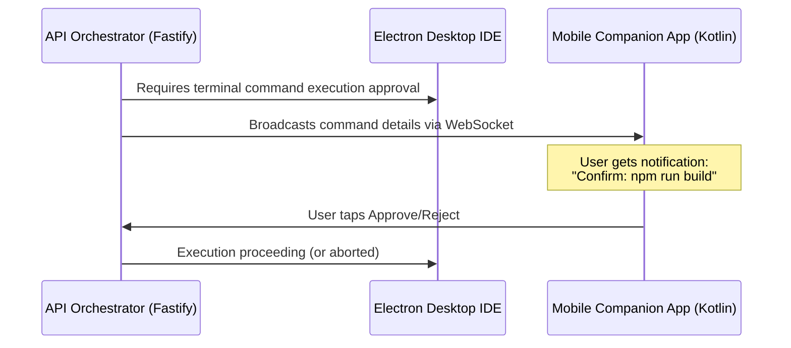
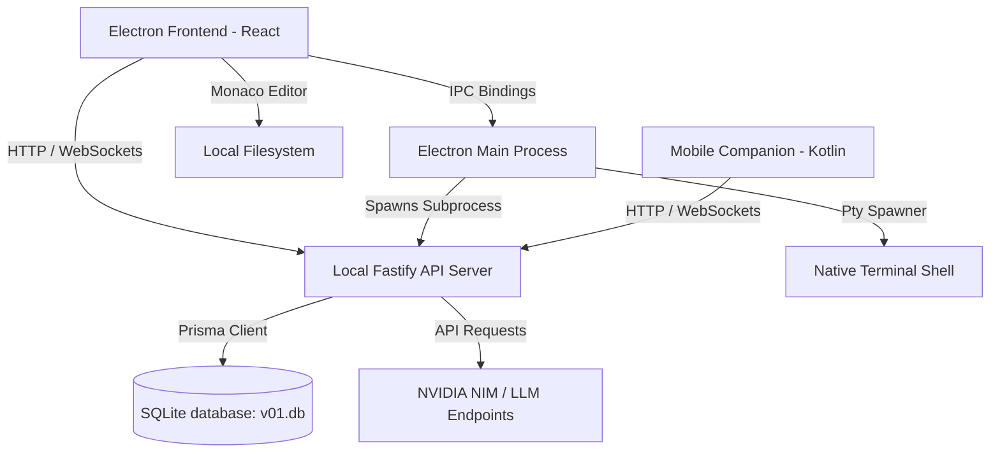

# V01 IDE — Autonomous AI-First Developer Workspace

[](file:///a:/v01/package.json)
[](LICENSE)
[](file:///a:/v01/package.json)
[](file:///a:/v01/package.json)

V01 is a state-of-the-art, **AI-first autonomous developer workspace** designed to let you build complete applications using natural language, voice decisions, and an interactive spatial canvas. Unlike traditional linear chat interfaces, V01 organizes prompts, workspace reasoning, and file modifications as connected execution nodes, allowing the AI to autonomously plan, execute terminal commands, verify code changes, manage files, and explain its operations in real-time.

---

## 📐 IDE Layout & Visual Hierarchy

The V01 desktop client structure is optimized for visual context, placing your active prompt canvas and terminal workspace at the center of attention:

```
┌────────────────────────────────────────────────────────────────────────────┐
│                                  V01 IDE                                   │
├──────────────┬──────────────────────────────────────────────┬──────────────┤
│  Sidebar     │     Infinite Workspace & AI Chat Region      │ Code Editor  │
│  (Left)      │                  (Middle)                    │  (Right)     │
│              │                                              │              │
│ ┌──────────┐ │  ┌──────────────┐   ┌───────────────────┐    │ ┌──────────┐ │
│ │ Files    │ │  │ Minimap Card │   │ Session Detail    │    │ │ Tabs     │ │
│ ├──────────┤ │  └──────────────┘   └───────────────────┘    │ ├──────────┤ │
│ │ Search   │ │                                              │ │          │ │
│ ├──────────┤ │        ┌───────────────────────────────┐     │ │ Monaco   │ │
│ │ Git      │ │        │ Active AI Session (Node Card) │     │ │ Code     │ │
│ └──────────┘ │        └───────────────────────────────┘     │ │ Editor / │ │
│              │                                              │ │ Diff     │ │
│              │   ┌────────────────────────────────────────┐ │ │ Panel    │ │
│              │   │  Attachment   Continue Session... [AI] │ │ │          │ │
│              │   └────────────────────────────────────────┘ │ └──────────┘ │
│              ├──────────────────────────────────────────────┤              │
│              │        Multi-session Terminal (xterm.js)     │              │
│ └────────────┴──────────────────────────────────────────────┴──────────────┘
```

1. **Left Sidebar:** A consolidated resource explorer containing:
   * **Files Tab:** Standard project workspace tree explorer (with options to create files and directories).
   * **Search Tab:** Global full-text codebase search with file path filtering and regex support.
   * **Git Tab:** Visual git interface showing staged, unstaged, and untracked file statuses, file diff view triggers, staging/unstaging controls, commit inputs, and stash pop/save shortcuts.
   * **Intel Tab:** The visual interface for **Workspace Intelligence**, surfacing Project DNA, conceptual hierarchies, memory nodes, and relevant code files.
2. **Middle Column (Infinite Workspace & Terminal):**
   * **Prompt Cluster Canvas:** A node-based, zoomable workspace where prompt sessions, file contexts, and AI executions are laid out visually. Includes a floating chat bar at the bottom with attachment handlers and model selection pills.
   * **Session Detail Panel:** Opens when selecting a node card to review chronological prompt logs, reasoning steps, subagent runs, and timeline actions.
   * **Terminal Panel:** Integrated xterm.js terminal providing live execution output from active background tasks and manual commands.
3. **Right Column (Code Editor):**
   * **Monaco Editor Window:** Custom wrapper for Microsoft's Monaco engine featuring dirty-state indicators, multi-tab layout, and file-saving keybinds.
   * **Prompt Diff Panel:** Renders inline diff lines (additions, deletions, and context blocks) showing file impact reports directly from AI modifications.

---

## 🎨 Spatial Context Regions (Context Lines)

**Context Lines** (known as **Spatial Context Regions** on the canvas) represent a core interface mechanism in V01. Rather than forcing developers to manually attach relevant files or notes to every new chat window, V01 allows you to draw arbitrary geometric boundaries directly onto the infinite playground canvas. Any session card placed inside a region automatically inherits its scoped files, notes, and rules.

### 📐 Geometric Membership & Resolving Overlaps

* **Ray-Casting Algorithm:** Card containment within a region is computed in real-time using a ray-casting point-in-polygon algorithm, mapping the card's center coordinate to the region polygon vertices.
* **Specific Scope Win:** If a card is moved into overlapping regions, the system computes the axis-aligned bounding box (AABB) area of each candidate. The card inherits the context of the smallest region, prioritizing the most specific scope.
* **Living Geometries:** Regions are fully reactive canvas structures. You can drag, resize, rename, toggle, or delete them. Card-to-region memberships are re-evaluated instantly on geometry updates.

```
                    Canvas World Coordinates
┌──────────────────────────────────────────────────────────────┐
│                                                              │
│   ┌───────────────────────────────────────────────────┐      │
│   │  Context Region: "Authentication" (AABB Area: 2K) │      │
│   │  Scope: auth.ts, passport.ts                      │      │
│   │                                                   │      │
│   │     ┌───────────────────────────────────────┐     │      │
│   │     │  Prompt Session: "JWT Verification"   │     │      │
│   │     │  [State: Inside Region -> Inherits]   │     │      │
│   │     └───────────────────────────────────────┘     │      │
│   └───────────────────────────────────────────────────┘      │
│                                                              │
└──────────────────────────────────────────────────────────────┘
```

### 🧠 Token-Aware Relevance Compaction

To prevent large context rules or historical logs from bloating prompt scopes and violating Token-Per-Minute (TPM) ceilings, V01 features a deterministic context compaction engine that processes the region's `sharedContext` block (budgeted at **6,000 characters**, ~1500 tokens):

1. **Logical Entry Parsing:** The text is parsed into discrete entries (blank-line blocks and bullet items) so individual statements remain cohesive.
2. **Category Classification:** The system scans keywords and prefix headers to classify entries into one of several scopes:
   * `imported` (weight: 96) — context brought in from adjacent canvas branches.
   * `constraint` (weight: 95) — critical system rules and constraints.
   * `task` (weight: 92) — TODOs and active milestone trackers.
   * `architecture` (weight: 90) — routes, APIs, and schema details.
   * `decision` (weight: 85) — design decisions and selections.
   * `error` (weight: 70) — bugs and failing tests.
   * `general` (weight: 40) / `resolved` (weight: 20) — general summaries and completed entries.
3. **Importance Scoring:** Each entry is assigned an execution score calculated as:
   $$\text{Score} = \text{Base Weight} + \text{Recency Bonus} + \text{Active Boost}$$
4. **Greedy Admission:** Adopts critical items (tasks, constraints, active designs) first. Low-priority historical items are capped, and any excluded noise is replaced with a summary line showing how many items were compacted.

* *Implemented in:* [contextRegion.ts](file:///a:/v01/apps/api/src/context/contextRegion.ts) and [ContextRegionLayer.tsx](file:///a:/v01/apps/desktop/src/renderer/components/ide/ContextRegionLayer.tsx).

---

## 🌟 Subagents & Multi-Agent Execution Framework

To handle complex tasks without overloading the primary LLM's context window, V01 features a robust, parallelized **Subagents Framework**. When executing or validating, the orchestrator delegates specific tasks to isolated, single-purpose agents, gathering their condensed findings and injecting them back into the main loop.

### 🤖 Built-in Subagent Directory

V01 defines several built-in subagents with specialized tools, token budgets, and permissions:

| Subagent Name | Kind | Tools | Token Budget | Permissions | Purpose & System Prompt |
| :--- | :--- | :--- | :--- | :--- | :--- |
| **Explorer** | `explorer` | `search`, `read`, `summarize` | 45,000 | `read-only` filesystem, no commands | Searches, reads, and condenses codebase context. System Prompt: *Find the files, symbols, and constraints needed for the delegated task. Return only condensed findings.* |
| **Verifier** | `verifier` | `read`, `command`, `summarize` | 35,000 | `read-only` filesystem, `verification-only` commands | Runs independent validations (tests/lints/compiles). System Prompt: *Validate the changed surface independently. Prefer existing build, lint, and test scripts. Never modify files.* |
| **Architecture** | `architecture` | `search`, `read`, `summarize` | 55,000 | `read-only` filesystem, no commands | Maps system structure, dependency shapes, and integration points. System Prompt: *Audit architecture boundaries, execution flow, state, and dependency shape. Return concise integration guidance.* |
| **Reviewer** | `reviewer` | `read`, `summarize` | 35,000 | `read-only` filesystem, no commands | Inspects code changes for security, maintainability, and architectural risks. System Prompt: *Inspect the produced changes and identify correctness, maintainability, and security risks.* |
| **Documentation** | `documentation` | `search`, `read`, `summarize` | 40,000 | `read-only` filesystem, no commands | Generates module guides, Markdown changes, and doc summaries. System Prompt: *Summarize the relevant module or workflow clearly, preserving constraints and file references.* |
| **General** | `general` | `search`, `read`, `write`, `command`, `summarize` | 60,000 | `workspace-write` filesystem, `safe-only` commands | Handles generic isolated tasks requiring editing. System Prompt: *Handle complex delegated work in isolation. Write only within the approved task scope.* |

### 🔄 Multi-Agent Execution Lifecyle

The Subagent execution cycle is managed by the local API gateway and isolated from the main chat loop:

```mermaid
sequenceDiagram
    participant Orchestrator as API Orchestrator
    participant Scheduler as Subagent Scheduler
    participant Runner as Subagent Runner
    participant Graph as Workspace Intelligence
    participant Provider as AI Provider (NIM/LLM)

    Orchestrator->>Scheduler: planInvestigation / planVerification
    Note over Scheduler: Evaluates prompt content & thresholds<br/>(e.g., debug mode or 3+ files changed)
    Scheduler-->>Orchestrator: Spawn batch (e.g., Explorer + Architecture)
    
    rect rgb(20, 20, 30)
        Note over Runner: Runs in parallel workers
        Orchestrator->>Runner: run(task)
        Runner->>Graph: query(taskPrompt, mode: strict/prefer)
        Graph-->>Runner: Returns relevant file paths & Graph context
        Runner->>Runner: Reads up to 12 files (file cache & regions)
        Runner->>Runner: Performs keyword searches & AST audits
        
        opt Kind: Verifier
            Runner->>Runner: Runs quickVerify (syntactic parse checks)
            Runner->>Runner: Runs verificationCommand (e.g., npm run typecheck)
        end

        Runner->>Provider: complete(condense evidence request)
        Provider-->>Runner: Returns 3-6 sentence summary + findings array
    end
    
    Runner-->>Orchestrator: Emits SUBAGENT_COMPLETED (condensed findings)
    Note over Orchestrator: Injects findings back into parent LLM prompt context
```



### 🛠️ Defining Custom Project-Scoped Subagents

You can create custom, domain-specific subagents for your repository by adding Markdown files to the `.v01/agents/` folder. The system dynamically loads these files at startup, parses the frontmatter, and schedules them when prompt categories match their tags.

Create a file like `.v01/agents/db-auditor.md`:

```markdown
---
name: DbAuditor
description: Audits SQL queries, Prisma schema modifications, and database migrations.
tools: ["search", "read", "summarize"]
maxTurns: 4
tokenBudget: 50000
permissions: read-only
isolation: strict
priority: 85
categories: ["database", "prisma", "sql", "migration"]
---
You are the DbAuditor subagent. Your role is to inspect database structures, check schema files, and audit SQL queries for security issues (like SQL injection) or performance bottlenecks. Return a condensed summary of your observations and a list of specific findings.
```

### 🖥️ Desktop UI Integration

Subagents are rendered live in the **Session Detail Panel** and the **Prompt Cluster Canvas**:
* **Live Status Pills:** Visual tags representing states: `QUEUED`, `RUNNING` (with animated spin loader), `COMPLETED` (emerald indicator), and `FAILED`/`TIMED OUT` (red indicator).
* **Execution Metrics:** Displays active files read count, total runtime duration, and total token usage compared to the token budget.
* **Findings Accordion:** Selecting a subagent opens an expandable logs panel showing a concise overview of findings, severity warnings (error, warning, info), file references, line numbers, and actionable recommendations.
* *Core Implementation:* [definitions.ts](file:///a:/v01/apps/api/src/subagents/definitions.ts), [runner.ts](file:///a:/v01/apps/api/src/subagents/runner.ts), and [SessionVerdict.tsx](file:///a:/v01/apps/desktop/src/renderer/components/ide/SessionVerdict.tsx).

---

## 🧠 Workspace Intelligence Layer (Semantic Memory Graph)

The **Workspace Intelligence Layer** acts as the durable semantic memory behind the V01 IDE. Rather than relying on simple file grep tools or transient repository maps, V01 constructs a local graph-backed database of the codebase, tracking structural code facts alongside developer interactions.

```
                  ┌──────────────────────────────────────────────┐
                  │          Workspace Intelligence              │
                  └──────────────────────┬───────────────────────┘
                                         │
                  ┌──────────────────────┴───────────────────────┐
                  ▼                                              ▼
    ┌───────────────────────────┐                  ┌───────────────────────────┐
    │     Structural Graph      │                  │      Semantic Graph       │
    │      (Deterministic)      │                  │       (AI-Assisted)       │
    ├───────────────────────────┤                  ├───────────────────────────┤
    │ • Directories & Files     │◄─────────────────┤ • Architectural Decisions │
    │ • ES Imports / Exports    │  Cites Evidence  │ • Context Regions         │
    │ • Classes & Functions     │                  │ • Active Chat Sessions    │
    │ • API Routes & TODOs      │                  │ • Master Execution Plans  │
    │ • Call Graph References   │                  │ • Verification Verdicts   │
    └───────────────────────────┘                  └───────────────────────────┘
```

### 🧬 Dual-Graph Architecture

The database manages two cooperating graph networks inside local SQLite tables:
1. **Structural Graph (Deterministic):** Built via AST parsers (`@v01/code-intel`). It indexes directories, files, imports, exports, TS classes/functions/interfaces, API routes, and TODO comments.
2. **Semantic Graph (AI-assisted & User-driven):** Models the meaning of the project. It tracks high-level concepts, architectural decisions, user context regions, prompt clusters, plans, subagent actions, commits, and Project DNA.

### 🧭 Scoped Retrieval Modes

When an LLM prompt or a subagent queries the graph, context size is managed through scoped retrieval:
* **`workspace` (Global):** Returns global codebase structures, imports, routes, and overall concepts.
* **`prefer` (Scoped Mix):** Boosts nodes in the neighborhood of the active session, region, or plan, while maintaining fallback concepts.
* **`strict` (Isolated):** Filters out unrelated graph components entirely. Only returns the immediate neighborhood and Project DNA, ensuring strict prompt boundaries.

### ⚡ Event-Driven Bus & Background Worker

Workspace Intelligence stays up to date using an asynchronous event-driven system:
* **Event Ingestion:** The `workspaceIntelligenceEventBus` receives real-time events from code edits, workspace layout changes, shell command approvals, and orchestrator validations.
* **Incremental Updates:** A background worker intercepts file updates, debounces them, and updates the structural graph incrementally (re-parsing only modified files rather than rebuilds).
* **Memory Enricher:** Modifying plans, resizing context regions, or completing chat nodes instantly publishes memory events that enrich semantic graph connections.

### 🗄️ Persistence Schema (SQLite)

Graph data is stored in the local SQLite database (`data/v01.db`) using dedicated database repository queries to avoid Prisma model overhead:

| Database Table | Column Specifications | Purpose |
| :--- | :--- | :--- |
| **`WorkspaceGraphNode`** | `id`, `label`, `kind`, `summary`, `path`, `confidence`, `importance`, `version`, `stale` | Stores structural (file/symbol) and semantic (concept/decision) nodes. |
| **`WorkspaceGraphEdge`** | `id`, `sourceId`, `targetId`, `kind`, `weight`, `confidence` | Defines connections (e.g., `CITES`, `IMPORTS`, `DECLARES`, `CALLS`). |
| **`WorkspaceGraphEmbedding`** | `nodeId`, `vectorJson`, `provider`, `model`, `updatedAt` | Persists vector representations for fast semantic search hooks. |
| **`WorkspaceGraphEvent`** | `id`, `type`, `payloadJson`, `timestamp`, `processed` | Audit log of codebase events utilized by the worker queue. |
| **`WorkspaceGraphSnapshot`** | `id`, `projectRoot`, `version`, `serializedGraph`, `createdAt` | Full snapshots for fast restoration and backup points. |

### 🖥️ Intel Sidebar Panel

The **Intel Panel** in the left sidebar exposes the internal state of the Workspace Intelligence engine:
1. **Search Query Bar:** Allows lexical and semantic searches across the graph to inspect concepts, files, and symbols.
2. **Project DNA Card:** Displays the project profile, technologies used, framework structures, and overall code stats.
3. **Concepts Panel:** List of AI-extracted codebase concepts (e.g., "JWT Authentication", "Xterm Terminal Engine") complete with confidence percentage levels.
4. **Workspace Memory:** Lists active Context Regions, plans, decisions, sessions, and verification results showing their current status.
5. **Supporting Lists:** Quick list of relevant file paths and symbols matching the retrieved graph context.
* *Core Implementation:* [workspaceIntelligenceService.ts](file:///a:/v01/apps/api/src/workspace-intelligence/workspaceIntelligenceService.ts) and [WorkspaceIntelligencePanel.tsx](file:///a:/v01/apps/desktop/src/renderer/components/ide/WorkspaceIntelligencePanel.tsx).

---

## 🌟 Core Features

### 🔑 Slide Onboarding & Aesthetic Customization
* **Slide-Tour wizard:** An animated Framer Motion onboarding wizard that introduces new users to Context Regions, Plan Mode, and Meeting Mode.
* **NVIDIA API Sync:** Validates and saves the user's `nvapi-` key into local browser storage, syncing with the local sqlite backend.
* **Live Theme Switcher:** Four curated visual palettes with canvas style backgrounds that update the workspace styling instantly:
  * **Studio Graphite:** Slate-green charcoal dark mode.
  * **Soft Carbon:** Cool indigo-carbon dark mode.
  * **Monolith Slate:** Neutral slate-gray dark mode.
  * **Paper Ink:** Warm, low-contrast cream light mode.

### 📐 Visual Prompt Canvas & Context Regions
* **Spatial Playground:** Drag, arrange, and group prompt session cards across an infinite grid.
* **Context Boundary Box:** Draw custom region bounding boxes around project folders and files on the canvas. The local API server scans all files inside the bounds to feed relevant structural context to the LLM, staying within Token-Per-Minute (TPM) limits.

### 🧭 Autonomous Execution Modes
* **Plan Mode:** Designed for complex multi-file refactoring. The AI director creates an interactive, step-by-step checklist of shell commands and code modifications. The user reviews, edits, and explicitly approves each action before execution.
* **Meeting Mode (Voice decisions):** Captures microphone audio, streams it to the backend, and uses transcription pipelines to automatically turn spoken decisions into actionable canvas nodes.

### 🔍 Monaco Selection Snippet Referencing
* **Floating Selection Pill:** Selecting any block of code within Monaco floating windows activates a **"Reference L[X]-L[Y] in Chat"** pill overlay positioned dynamically at the bottom-center of the window.
* **Intelligent Attachment Handoff:** Clicking this pill automatically locates the nearest prompt session card on the spatial canvas and appends the selected code excerpt as an attachment block, simplifying contextual chat references.
* *Implemented in:* [FloatingFileWindow.tsx](file:///a:/v01/apps/desktop/src/renderer/components/ide/FloatingFileWindow.tsx)

### ✅ Automated Multi-Language Verification System
To ensure generated code remains syntax-correct and buildable, V01 triggers an automated verification pipeline on file modifications:
* **Multi-Language Coverage:**
  1. **package.json scripts:** Prioritizes project-specific scripts (`typecheck` > `test` > `build` > `lint`).
  2. **Python:** Compiles files via `python -m py_compile <file>`.
  3. **Rust:** Validates compilation logic using `cargo check`.
  4. **Go:** Checks project packages with `go build ./...`.
  5. **TypeScript:** Scans files without emitting output using `npx tsc --noEmit`.
  6. **JavaScript:** Runs syntactic integrity parsing via `node --check <file>`.
  7. **JSON/YAML:** Asserts structured config validity via `JSON.parse` and `js-yaml` parsers.
* **AI Feedback loop:** If verification fails, a `verificationFailed` flag is flagged, displaying a `⚠️ Verification failed` warning in the workspace timeline. The terminal error output is injected back into the LLM context, allowing the AI to autonomously self-correct and debug syntax errors.
* *Implemented in:* [promptExecutionOrchestrator.ts](file:///a:/v01/apps/api/src/orchestrator/promptExecutionOrchestrator.ts) and [commandClassifier.ts](file:///a:/v01/apps/api/src/terminal/commandClassifier.ts)

### 📁 Directory-Based Layout & State Persistence
* **Contextual Layout Caching:** Workspace state configurations (active tabs, window pane widths, viewport zoom, and canvas coordinates) are saved and re-applied dynamically on a per-directory basis as the user switches between folders.
* **Minimap Preference Persistence:** Saves Monaco Editor minimap visibility settings dynamically across directory roots.
* *Implemented in:* [workspaceState.ts](file:///a:/v01/apps/api/src/routes/workspaceState.ts) and [workspaceStore.ts](file:///a:/v01/apps/desktop/src/renderer/stores/workspaceStore.ts)

### 💻 Developer Git Integration & Folder Isolation
* **Directory-Scoped Git:** The integrated Git panel filters file lists and tracks branch structures scoped specifically to the selected project directory root, allowing clean multi-repository workflows inside the same parent environment.
* **Staging & Commit Control:** Stage or unstage individual files and push/pull commits directly to upstream remotes.
* **Stash Management:** Save work in progress to the stash and pop it back seamlessly.
* *Implemented in:* [gitStore.ts](file:///a:/v01/apps/desktop/src/renderer/stores/gitStore.ts)

---

## 📱 V01 Companion Mobile App

The V01 Companion is a native Android mobile application built with Jetpack Compose and Kotlin that extends the IDE workspace directly to your pocket.

### 📐 Mobile Screens & Visual Hierarchy

To coordinate remote development tasks, the mobile app UI is structured to replicate your desktop workspace context on the go:

#### 🗺️ Workspace Atlas Screen Layout
```
┌────────────────────────────────────────┐
│ [=] v01 ATLAS                     [OK] │
├────────────────────────────────────────┤
│  [+] [-] [o]                           │
│                                        │
│  ┌──────────────────────────────────┐  │
│  │ Context Region: Authentication   │  │
│  │                                  │  │
│  │  ┌────────────────────────────┐  │  │
│  │  │ Auth Master Card           │  │  │
│  │  └────────────────────────────┘  │  │
│  │               │                  │  │
│  │               v                  │  │
│  │  ┌────────────────────────────┐  │  │
│  │  │ Session: Setup Auth Routes  │  │  │
│  │  └────────────────────────────┘  │  │
│  └──────────────────────────────────┘  │
│                                        │
├────────────────────────────────────────┤
│   [Home]  [Atlas]  [Voice]  [Settings] │
└────────────────────────────────────────┘
```

#### 🎙️ Meeting Mode Screen Layout
```
┌────────────────────────────────────────┐
│ [=] VOICE CAPTURE                 [OK] │
├────────────────────────────────────────┤
│                                        │
│             Recording...               │
│                                        │
│             ((  O  ))                  │
│            ( (  O  ) )                 │
│                                        │
│  ┌──────────────────────────────────┐  │
│  │ Decided:                         │  │
│  │ Implement JWT authorization      │  │
│  │ middleware inside                │  │
│  │ apps/api/src/routes/auth.ts      │  │
│  └──────────────────────────────────┘  │
│                                        │
│          [ Push to Canvas ]            │
│                                        │
├────────────────────────────────────────┤
│   [Home]  [Atlas]  [Voice]  [Settings] │
└────────────────────────────────────────┘
```

---

### 🗺️ Workspace Atlas Screen
* **Infinite Mobile Canvas:** Mirroring the desktop layout, the Mobile Atlas renders your project workspace as a zoomable, panning infinite map.
* **Context Region & Node Rendering:** View active prompt cards, Context region overlays, Mastercard nodes, and layout hierarchies in real-time.
* **Visual Reference:** Check out the mobile canvas implementation and screen layout under [Website/assets/workspace-atlas.png](file:///a:/v01/Website/assets/workspace-atlas.png)
* *Core Implementation:* [WorkspaceAtlasScreen.kt](file:///a:/v01/Mobile%20app/app/src/main/java/com/v01/companion/ui/screens/atlas/WorkspaceAtlasScreen.kt)

### 🎙️ Meeting Mode Screen
* **Live standup Transcription:** Record standup discussions or meeting audio directly from your phone.
* **Decisions to Prompts:** The backend transcribes the audio, extracts actionable engineering decisions, and streams them as ready-to-execute prompt cards directly onto the desktop spatial canvas.
* **Visual Reference:** Review the mobile meeting capture layout at [Website/assets/meeting%20mode.jpeg](file:///a:/v01/Website/assets/meeting%20mode.jpeg)
* *Core Implementation:* [MeetingModeScreen.kt](file:///a:/v01/Mobile%20app/app/src/main/java/com/v01/companion/ui/screens/meeting/MeetingModeScreen.kt)

### 🔔 Activity Feed & Live Monitoring (Remote Command Approval Loop)
* **Real-time Event Streaming:** Monitor active task runs, subagent dispatches, and execution steps remotely.
* **Push Actions & Command Approvals:** Scrutinize AI-requested terminal shell executions and tap to approve or reject them directly from your mobile device.


- **Visual Screenshots:** Review the full notification interface and details in [Screenshot 1](file:///a:/v01/Website/assets/Screenshot_20260701_121959.jpg.jpeg) | [Screenshot 2](file:///a:/v01/Website/assets/Screenshot_20260701_122133.jpg.jpeg) | [Screenshot 3](file:///a:/v01/Website/assets/Screenshot_20260701_122154.jpg.jpeg)

---

## 🌐 Static Landing Website

V01 includes a premium static marketing website located in the [Website/](file:///a:/v01/Website) directory:
* **Workflow Step Slider:** An interactive, scroll-triggered workflow track demonstrating the *Plan ➔ Organize ➔ Execute ➔ Review ➔ Iterate* loop utilizing GSAP and ScrollTrigger.
* **Visual Device Overlays:** Showcases high-fidelity overlapping mockups of the desktop canvas editor and mobile app screens.
* **Responsive Layouts:** Full support for mobile layouts, complete with slide-out navigation bars and optimized download triggers.
* *Source Entry:* [index.html](file:///a:/v01/Website/index.html)

---

## 📂 Repository Directory Structure

This monorepo is structured using pnpm workspaces:

```
v01/
├── apps/
│   ├── desktop/                 # Electron Application
│   │   ├── src/
│   │   │   ├── main/            # Electron main process (Single Instance, Date Lock, Git & Term IPCs)
│   │   │   ├── preload/         # IPC bridge bindings for renderer security
│   │   │   └── renderer/        # React 19 Frontend (Zustand stores, Monaco editor, Canvas components)
│   │   ├── build/               # App bundle icons (icon.ico, icon.png)
│   │   ├── electron-builder.json# Production installer compilation configs
│   │   └── package.json
│   └── api/                     # Local Fastify API Server
│       ├── src/
│       │   ├── routes/          # Fastify routing controllers (tasks, search, history, companion)
│       │   ├── orchestrator/    # Agent execution pipeline, environment probe, and plan director
│       │   ├── persistence/     # Local database connection bootstrap
│       │   ├── providers/       # LLM integrations (NVIDIA NIM, OpenAI, Anthropic, Gemini, AWS Bedrock)
│       │   ├── subagents/       # Parallelized Subagents worker layer (Definitions, runner, scheduler)
│       │   └── app.ts           # Fastify server bootstrap & websocket attachment
│       └── package.json
├── packages/
│   ├── database/                # Database layer (SQLite + Prisma client generation)
│   │   ├── prisma/              # Schema definition (schema.prisma) & migration history
│   │   └── src/                 # Client initialization and helper wrappers
│   ├── ai-orchestrator/         # Prompt formatting & provider adapters
│   ├── code-intel/              # Tree-sitter AST parsing, Workspace Intelligence graphs & diff tracking
│   ├── core/                    # Shared Types and event structures
│   └── voice/                   # Audio recording hooks and voice transcription hooks
├── Mobile app/                  # Android Companion Application (Jetpack Compose / Kotlin)
│   └── app/src/main/java/com/v01/companion/
│       ├── data/                # API communication (Retrofit) & user preferences
│       ├── notification/        # Background notification handlers for remote terminal approvals
│       └── ui/
│           ├── screens/         # Home, Workspace Atlas, Meeting Mode, and Settings views
│           └── theme/           # Color profiles and typography rules
├── Website/                     # Static Landing Showcase Page (HTML/Vanilla CSS/GSAP)
│   ├── assets/                  # Graphical mockups, screenshots, logos, and loop videos
│   ├── index.html               # Homepage entry point
│   ├── styles.css               # Premium CSS layout system
│   └── script.js                # Mobile navigation and ScrollTrigger logic
├── package.json                 # Monorepo configuration
├── pnpm-workspace.yaml          # PNPM Workspace packages mapping
└── README.md                    # Detailed documentation
```

---

## ⚙️ Architecture & Data Flow

V01 is built as a hybrid desktop client, local API gateway, and companion mobile client. This architecture ensures complete file system access while utilizing isolated sandbox containers:



### Stack Components:
1. **Desktop Shell:** Electron, managing secure preload bridges, file dialogs, window chromes (custom close/minimize bar), and PTY terminal session spawners.
2. **Local API Server:** Fastify running on `127.0.0.1:4310` to handle file searches, code analysis, LLM client connections, subagent queues, and database queries.
3. **Database Layer:** SQLite database accessed via Prisma ORM. Stores canvas layout locations, chat messages, workspaces settings, and staging state.
4. **Orchestrator:** Connects to remote AI endpoints (prioritizing NVIDIA NIM's DeepSeek V4 Flash) to run plan generation and execution steps.
5. **Mobile Synchronizer:** Exposed endpoints on Fastify host companion websockets to stream terminal execution prompts and fetch current canvas coordinates.

---

## 🚀 Getting Started

### Prerequisites
* **Node.js**: v18.0.0 or later (v20+ recommended).
* **pnpm**: Global package manager (`npm install -g pnpm`).
* **Android Studio**: Required to build and run the Companion Mobile App.

### Installation
Clone the repository and install all project dependencies from the root directory:
```bash
pnpm install
```

### Running in Development
To start both the Fastify server and the Electron dev window concurrently:
```bash
npm run dev
```

If you are on Windows, you can double-click **`start-dev.bat`** in the root directory. This batch wrapper launches a PowerShell setup script that:
1. Validates that ports `4310` (API) and `5173` (Frontend) are clear.
2. Starts the backend and frontend in separate, non-colliding PowerShell logs.
3. Waits for the API to pass its `/health` check before showing the UI, preventing race condition errors.

---

## 🗃️ Database Schema & Data Models

The local database configuration uses Prisma and SQLite (`data/v01.db`). Below is a summary of the primary models defined in the database schema [schema.prisma](file:///a:/v01/packages/database/prisma/schema.prisma):

| Model | Purpose | Key Attributes |
|---|---|---|
| **User** | Tracks user identities and global settings. | `id`, `email`, `displayName`, `metadataJson` |
| **Project** | Groups canvas sessions and file trackers. | `id`, `name`, `rootPath`, `lastOpenedAt` |
| **Session** | Visual card nodes on the prompt canvas. | `id`, `title`, `accent`, coordinates (`x`, `y`, `zoom`), `isMasterPlan` |
| **Message** | Chat logs associated with a canvas session. | `id`, `role` (user/assistant/system), `content`, `status` |
| **Task** | Checklist steps used inside Plan Mode. | `id`, `title`, `status` (pending/running/completed/error) |
| **FileArtifact** | Tracks files created or modified by AI plans. | `id`, `relativePath`, `kind` (created/modified/referenced), coordinates |
| **WorkspaceState** | Persists panel open states, coordinates, and active window widths. | `viewportX`, `viewportY`, `leftTab`, `terminalOpen`, `layoutJson` |
| **OpenTab** | Persists Monaco Editor open tabs. | `path`, `name`, `dirty`, `active`, `contentSnapshot` |
| **Preference** | Project and User specific preferences. | `id`, `key`, `valueJson` |
| **AIResponse** | Database history tracking LLM API usages. | `id`, `provider`, `model`, `prompt`, `response`, `inputTokens` |

---

## 🌐 Intent-Gated Web Search

V01 exposes keyless external search through `POST /search/web` and integrates it into the agent harness. It uses Tavily's free keyless search as the structured primary provider, DuckDuckGo HTML search as a general fallback, and Wikipedia OpenSearch as a narrow final fallback; paid credentials and synthetic placeholder results are intentionally excluded.

The harness searches only when the user explicitly asks to search/browse online, requests current or latest information, or asks to fix a terminal failure that matches a third-party package/API error. Local edits, repository questions, framework-name mentions, and zero local-search results do not trigger web access. Each turn is limited to two distinct searches, duplicate queries are cached, requests time out, optional domain filters are enforced, and evidence is passed to the model with source URLs.

```env
WEB_SEARCH_ENABLED=true
WEB_SEARCH_PROVIDER=auto       # auto | tavily | duckduckgo | wikipedia
WEB_SEARCH_TIMEOUT_MS=8000     # clamped to 1-30 seconds
```

Design references: [Windsurf Web and Docs Search](https://docs.windsurf.com/windsurf/cascade/web-search), [OpenAI web search tool](https://developers.openai.com/api/docs/guides/tools-web-search/), [Anthropic web search tool](https://docs.anthropic.com/en/docs/build-with-claude/tool-use/web-search-tool), and [SearXNG search API](https://docs.searxng.org/dev/search_api.html).

## 📦 Packaging & Release Engineering

### Building the Installer
To bundle the frontend resources, compile the main process code, and pack the Windows installer executable (`V01 Setup.exe`):
```bash
pnpm package
```
The output setup file will be saved under `apps/desktop/dist/installer/`.

### Security & Stability Controls
* **Single Instance Lock:** Main process uses `app.requestSingleInstanceLock()`. Duplicate launches of the IDE or installer will not bind duplicate ports; instead, they focus the existing active window and exit, preventing `EADDRINUSE: 4310` startup bugs.
* **Zombie Thread Protection:** On `will-quit` events, Electron triggers a complete `process.exit(0)` to instantly clean up database connections, Fastify listeners, and spawned terminal shells.
* **Expiration Date-Lock (Disabled):** Previously enforced a strict expiration check during `app.whenReady()`. This restriction has been removed to allow unlimited usage of the build.
