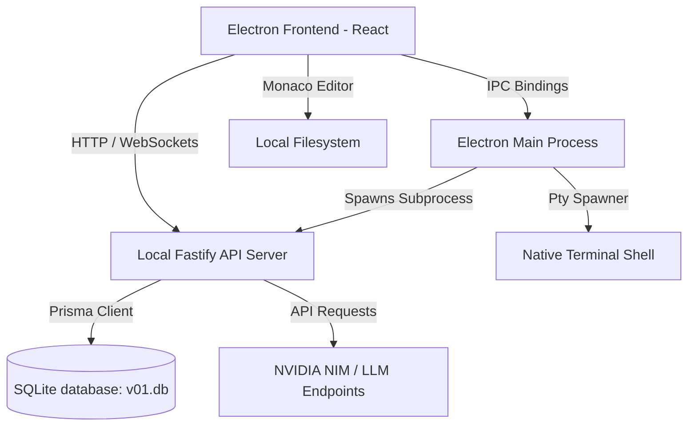

# V01 IDE — Autonomous AI-First Developer Workspace

V01 is a state-of-the-art, **AI-first autonomous developer workspace** designed to let you build complete applications using natural language, voice decisions, and an interactive spatial canvas. Unlike traditional linear chat interfaces, V01 organizes prompts, workspace reasoning, and file modifications as connected execution nodes, allowing the AI to autonomously plan, execute terminal commands, manage files, and explain its operations in real-time.

---

## 📐 IDE Layout & Visual Hierarchy

The V01 desktop client structure is optimized for visual context, placing your active prompt canvas and terminal workspace at the center of attention:

```
┌────────────────────────────────────────────────────────────────────────────┐
│                                  V01 IDE                                   │
├──────────────┬──────────────────────────────────────────────┬──────────────┤
│  Sidebar     │     Infinite Workspace & AI Chat Region      │ Code Editor  │
│  (Left)      │                  (Middle)                    │  (Right)     │
│              │                                              │              │
│ ┌──────────┐ │  ┌──────────────┐   ┌───────────────────┐    │ ┌──────────┐ │
│ │ Files    │ │  │ Minimap Card │   │ Session Detail    │    │ │ Tabs     │ │
│ ├──────────┤ │  └──────────────┘   └───────────────────┘    │ ├──────────┤ │
│ │ Search   │ │                                              │ │          │ │
│ ├──────────┤ │        ┌───────────────────────────────┐     │ │ Monaco   │ │
│ │ Git      │ │        │ Active AI Session (Node Card) │     │ │ Code     │ │
│ └──────────┘ │        └───────────────────────────────┘     │ │ Editor / │ │
│              │                                              │ │ Diff     │ │
│              │   ┌────────────────────────────────────────┐ │ │ Panel    │ │
│              │   │  Attachment   Continue Session... [AI] │ │ │          │ │
│              │   └────────────────────────────────────────┘ │ └──────────┘ │
│              ├──────────────────────────────────────────────┤              │
│              │        Multi-session Terminal (xterm.js)     │              │
└──────────────┴──────────────────────────────────────────────┴──────────────┘
```

1. **Left Sidebar:** A consolidated resource explorer containing:
   * **Files Tab:** Standard project workspace tree explorer (with options to create files and directories).
   * **Search Tab:** Global full-text codebase search with file path filtering and regex support.
   * **Git Tab:** Visual git interface showing staged, unstaged, and untracked file statuses, file diff view triggers, staging/unstaging controls, commit inputs, and stash pop/save shortcuts.
2. **Middle Column (Infinite Workspace & Terminal):**
   * **Prompt Cluster Canvas:** A node-based, zoomable workspace where prompt sessions, file contexts, and AI executions are laid out visually. Includes a floating chat bar at the bottom with attachment handlers and model selection pills.
   * **Session Detail Panel:** Opens when selecting a node card to review chronological prompt logs and reasoning steps.
   * **Terminal Panel:** Integrated xterm.js terminal providing live execution output from active background tasks and manual commands.
3. **Right Column (Code Editor):**
   * **Monaco Editor Window:** Custom wrapper for Microsoft's Monaco engine featuring dirty-state indicators, multi-tab layout, and file-saving keybinds.
   * **Prompt Diff Panel:** Renders inline diff lines (additions, deletions, and context blocks) showing file impact reports directly from AI modifications.

---

## 🌟 Core Features

### 🔑 Slide Onboarding & Aesthetic Customization
* **Slide-Tour wizard:** An animated Framer Motion onboarding wizard that introduces new users to Context Regions, Plan Mode, and Meeting Mode.
* **NVIDIA API Sync:** Validates and saves the user's `nvapi-` key into local browser storage, syncing with the local sqlite backend.
* **Live Theme Switcher:** Four curated visual palettes with canvas style backgrounds that update the workspace styling instantly:
  * **Studio Graphite:** Slate-green charcoal dark mode.
  * **Soft Carbon:** Cool indigo-carbon dark mode.
  * **Monolith Slate:** Neutral slate-gray dark mode.
  * **Paper Ink:** Warm, low-contrast cream light mode.

### 📐 Visual Prompt Canvas & Context Regions
* **Spatial Playground:** Drag, arrange, and group prompt session cards across an infinite grid.
* **Context Boundary Box:** Draw custom region bounding boxes around project folders and files on the canvas. The local API server scans all files inside the bounds to feed relevant structural context to the LLM, staying within Token-Per-Minute (TPM) limits.

### 🧭 Autonomous Execution Modes
* **Plan Mode:** Designed for complex multi-file refactoring. The AI director creates an interactive, step-by-step checklist of shell commands and code modifications. The user reviews, edits, and explicitly approves each action before execution.
* **Meeting Mode (Voice decisions):** Captures microphone audio, streams it to the backend, and uses transcription pipelines to automatically turn spoken decisions into actionable canvas nodes.

### 💻 Developer Git Integration
* **Staging Area:** Stage or unstage individual files.
* **Stash Management:** Save work in progress to the stash and pop it back seamlessly.
* **Branch Controller:** Switch branches (with collision warnings) and create new development branches.
* **Push/Pull Synchronization:** Pushes commits to remotes (`origin`, `pD`, etc.) and pulls upstream updates.

---

## 📂 Repository Directory Structure

This monorepo is structured using pnpm workspaces:

```
v01/
├── apps/
│   ├── desktop/                 # Electron Application
│   │   ├── src/
│   │   │   ├── main/            # Electron main process (Single Instance, Date Lock, Git & Term IPCs)
│   │   │   ├── preload/         # IPC bridge bindings for renderer security
│   │   │   └── renderer/        # React 19 Frontend (Zustand stores, Monaco editor, Canvas components)
│   │   ├── build/               # App bundle icons (icon.ico, icon.png)
│   │   ├── electron-builder.json# Production installer compilation configs
│   │   └── package.json
│   └── api/                     # Local Fastify API Server
│       ├── src/
│       │   ├── routes/          # Fastify routing controllers (tasks, search, history, meetings)
│       │   ├── orchestrator/    # Agent execution pipeline and plan director
│       │   ├── persistence/     # Local database connection bootstrap
│       │   ├── providers/       # LLM integrations (NVIDIA NIM, OpenAI, Anthropic, Gemini, AWS Bedrock)
│       │   └── app.ts           # Fastify server bootstrap & websocket attachment
│       └── package.json
├── packages/
│   ├── database/                # Database layer (SQLite + Prisma client generation)
│   │   ├── prisma/              # Schema definition (schema.prisma) & migration history
│   │   └── src/                 # Client initialization and helper wrappers
│   ├── ai-orchestrator/         # Prompt formatting & provider adapters
│   ├── code-intel/              # Tree-sitter AST parsing and structural diff tracking
│   ├── core/                    # Shared Types and event structures
│   └── voice/                   # Audio recording hooks and voice transcription hooks
├── package.json                 # Monorepo configuration
├── pnpm-workspace.yaml          # PNPM Workspace packages mapping
└── README.md                    # Detailed documentation
```

---

## ⚙️ Architecture & Data Flow

V01 is built as a hybrid desktop client and local API gateway. This architecture ensures complete file system access while utilizing isolated sandbox containers:



### Stack Components:
1. **Desktop Shell:** Electron, managing secure preload bridges, file dialogs, window chromes (custom close/minimize bar), and PTY terminal session spawners.
2. **Local API Server:** Fastify running on `127.0.0.1:4310` to handle file searches, code analysis, LLM client connections, and database queries.
3. **Database Layer:** SQLite database accessed via Prisma ORM. Stores canvas layout locations, chat messages, workspaces settings, and staging state.
4. **Orchestrator:** Connects to remote AI endpoints (prioritizing NVIDIA NIM's DeepSeek V4 Flash) to run plan generation and execution steps.

---

## 🚀 Getting Started

### Prerequisites
* **Node.js**: v18.0.0 or later (v20+ recommended).
* **pnpm**: Global package manager (`npm install -g pnpm`).

### Installation
Clone the repository and install all project dependencies from the root directory:
```bash
pnpm install
```

### Running in Development
To start both the Fastify server and the Electron dev window concurrently:
```bash
npm run dev
```

If you are on Windows, you can double-click **`start-dev.bat`** in the root directory. This batch wrapper launches a PowerShell setup script that:
1. Validates that ports `4310` (API) and `5173` (Frontend) are clear.
2. Starts the backend and frontend in separate, non-colliding PowerShell logs.
3. Waits for the API to pass its `/health` check before showing the UI, preventing race condition errors.

---

## 🗃️ Database Schema & Data Models

The local database configuration uses Prisma and SQLite (`data/v01.db`). Below is a summary of the primary models defined in the database schema:

| Model | Purpose | Key Attributes |
|---|---|---|
| **User** | Tracks user identities and global settings. | `id`, `email`, `displayName`, `metadataJson` |
| **Project** | Groups canvas sessions and file trackers. | `id`, `name`, `rootPath`, `lastOpenedAt` |
| **Session** | Visual card nodes on the prompt canvas. | `id`, `title`, `accent`, coordinates (`x`, `y`, `zoom`), `isMasterPlan` |
| **Message** | Chat logs associated with a canvas session. | `id`, `role` (user/assistant/system), `content`, `status` |
| **Task** | Checklist steps used inside Plan Mode. | `id`, `title`, `status` (pending/running/completed/error) |
| **FileArtifact** | Tracks files created or modified by AI plans. | `id`, `relativePath`, `kind` (created/modified), coordinates |
| **WorkspaceState** | Persists panel open states and active window widths. | `viewportX`, `viewportY`, `leftTab`, `terminalOpen` |
| **OpenTab** | Persists Monaco Editor open tabs. | `path`, `name`, `dirty`, `active`, `contentSnapshot` |

---

## 📦 Packaging & Release Engineering

### Building the Installer
To bundle the frontend resources, compile the main process code, and pack the Windows installer executable (`V01 Setup.exe`):
```bash
npm run package
```
The output setup file will be saved under `apps/desktop/dist/installer/`.

### Security & Stability Controls
* **Single Instance Lock:** Main process uses `app.requestSingleInstanceLock()`. Duplicate launches of the IDE or installer will not bind duplicate ports; instead, they focus the existing active window and exit, preventing `EADDRINUSE: 4310` startup bugs.
* **Zombie Thread Protection:** On `will-quit` events, Electron triggers a complete `process.exit(0)` to instantly clean up database connections, Fastify listeners, and spawned terminal shells.
* **Expiration Date-Lock (Disabled):** Previously enforced a strict expiration check during `app.whenReady()`. This restriction has been removed to allow unlimited usage of the build.

